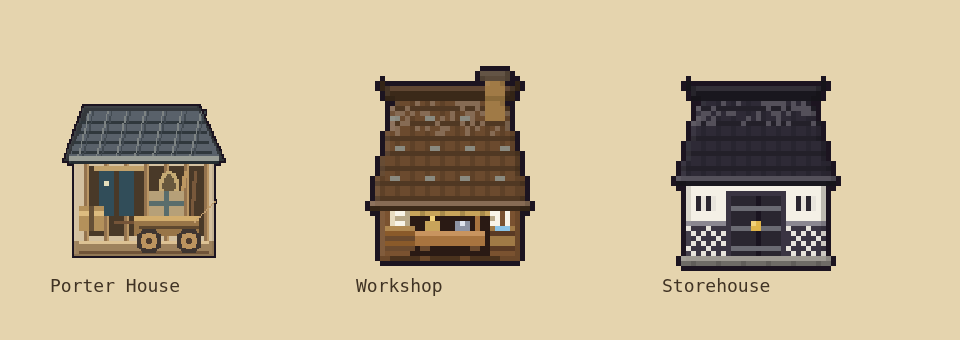

# Village building and worksite art direction

This guide records the player's correction to the Lumber Yard, Iron Mine and Porter House artwork. Those assets initially used finer pixels, thinner lines, washed-out timber and grey-green shading that did not belong beside the existing village. This is a rendering consistency requirement, not a requirement to give every building a roof.

The rules here apply to village structures and their fixed props. Character portraits, equipment and battle rigs have their own established rendering systems; do not reduce their detail to match building pixels.

## Reference family

Use the Workshop, Storehouse (`kura`), Smithy, Ton'ya, Thatched Hut and Longhouse as the built reference family, together with the existing fields, trees and rock deposits for outdoor sites. Compare proposed assets at the **same village zoom**, side by side. A detailed asset can look attractive in isolation and still be wrong for this game.



The top row shows the revised Lumber Yard, Iron Mine and Porter House. The six unchanged buildings below are the comparison references. The lumber and mine previews include an assigned worker's kit and actual output piles, so the left and right spaces can be assessed together.

Regenerate the sheet from the current standalone game with:

```sh
node tools/preview-worksites.cjs
```

This needs the development Playwright dependency and Chromium. `CHROMIUM_PATH` can select a local browser. The game itself needs neither.

## Pixel scale and outline

- Use the native `PB` grid for village structures and fixed worksite props. These revised 2×2 structures use a roughly 32-pixel-wide drawing before the outline. Adding source pixels through `ArtPB` changes their apparent texture and line weight even if the final display size is unchanged.
- Keep geometry on the logical pixel grid. Build detail from deliberate blocks and short stepped lines. Avoid fractional-width beams, hairline seams, fine grain, smooth gradients and miniature realistic facets.
- Use the established dark outer outline, `OUTLINE` (`#1c1420`), at one native pixel. Use strong internal separations around entrances, beams, wheels and tools. Do not replace the outline with a pale or thin contour.
- Preserve nearest-neighbour display (`imageSmoothingEnabled=false`). A larger display or a sharper export is not a reason to introduce a second pixel density.
- Reuse `roofTiles()` and `wallFront()` when their forms fit. Open yards, racks, mine mouths, fields, tents and roofless sites are equally valid. Their silhouettes should suit their role.

## Materials and colour

Reuse nearby buildings' colour families before inventing new ones. The values below are base colours; the existing painters and shading pass derive their shadows and highlights.

| Material | Existing colours and use |
|---|---|
| Structural timber | `#7a5230`, `#6b4a2e`; warm brown posts and beams |
| Fresh wood / edges | `#a8743f`, `#c8945f`; sparing upper edges and tool handles |
| Deep wood / recesses | `#4a321e`, `#2a1a14`; undersides, interior bays and joints |
| Log end grain | `#e0b884` with `#a8743f`; broad, readable cuts |
| Plaster / paper | `#efe6d0`, `#e8dcc0`; warm light surfaces, not the entire building |
| Slate / lacquered roof | `#3a3442`, `#4a4a52`; the established charcoal-violet family |
| Iron tools | `#8d93a3`, `#d8dce6`; compact cool metal accents |
| Exposed mine rock | `PAL.ore`, `PAL.oreD`, `PAL.oreL`; match map deposits |
| Worked soil | `#8a6a3a`, `#a07a46`, `#b8955e`; match fields and yards |
| Cloth accents | Indigo `#3b4a7a`, red `#c8452c`, green `#5f9e3e`; small role or mode cues |

Avoid a generic beige wash, desaturated grey-green timber, realistic silver rock gradients or a separate muted palette for a new building. An asset should still belong to the village when its sign, banner and label are hidden.

## Light, volume and texture

- Follow the shared upper/left light and darker lower/right edges. Use a few clear highlight, base and shadow clusters per material.
- Finish these native sprites with the established `shadeEdges(.88,1.06)` and `outlined(OUTLINE)` pipeline. Do not soften their contrast independently from adjacent buildings.
- Entrances need a dark opening and visible framing. Large timbers should read as timbers before grain or pegs are added. Rock should use chunky, simple cuts.
- Texture supports a readable shape. Do not cover every surface in speckles, tiny seams or decorative strokes. Keep the Edo/feudal identity through timber joinery, paper, cloth, hand tools and appropriate materials rather than modern industrial details.
- Roof shape is a choice for the individual asset. Neither this guide nor the current use of shared roof painters establishes a universal roof requirement.

## Silhouette, props and ground placement

Establish each site's purpose at normal zoom: a timber stack and work bay for lumber; rock, a timber-framed dark adit and mining tools for the mine; a hauling building with a parked cart for porters.

- Ground props must sit inside the intended work yard, not float above it or spill needlessly across a road or neighbouring field. Check their sprite offsets in the map, not only in an isolated preview.
- Keep the existing left work/assignment display and right output-stockpile areas readable. Test an assigned, productive building: an empty sprite can hide an overlap problem.
- The Lumber Yard's subtle assignment kit is a wooden chair and an axe stuck in a stump. The Iron Mine's kit is a pickaxe and a candle lantern. These are placed in their front-left yards using `WORKSITE_DUTY`; they should not obscure the work bay or mine entrance.
- Fields retain their own farming-tool treatment inside the field. Do not add a generic banner to every worker assignment.
- Leave established product banners, piles, doorways and focus displays legible. A decorative prop must not become a false interaction target.

### Permanent Porter House cart

The player explicitly requested a **cart or wheelbarrow in front of the Porter House**. Keep it in `porterHouseSprite()` so it remains visible even with zero assigned workers. It is part of the building's identity, not its conditional assignment marker.

The current wooden wheelbarrow has an open/sloping tray, two handles, a support leg and a large spoked wheel. Its wheel is drawn after the tray so it does not disappear behind the foundation. Keep enough separation and contrast that it reads as a barrow at ordinary village zoom, rather than as a bench, sill or crate. A small decorative overhang is acceptable; it must not alter the logical 2×2 footprint or entrance.

The parked barrow is empty decoration. Actual porter cargo remains part of the existing physical goods and carrying system; the prop must not fabricate, duplicate or stockpile goods.

### Formation forge upgrades

The four Training forges share a procedural level progression: **Level 1 has no roof chimney, Level 2 has one, Level 3 has two**. Each completed upgrade adds one clearly readable stone/clay flue. Keep the existing roof colours, formation plaque and left equipment rack, and preserve the red weapon / green armour banners in both modes. The common level silhouette should be recognizable without opening the forge panel.

Formation plaques use a 16×13 native-pixel panel with a dark cloth field, warm wood/gold edging and broad ivory/gold symbols: crossed swords, bow and arrow, matchlock, and horse head. These replace the small 10×8 panels. Keep the symbol large and distinct at normal and distant village zoom, with enough space between the chimneys and focus banner. Add detail within the established pixel grid; the building itself keeps the village's original pixel density. The procedural preview includes 2× and 1× overviews for checking recognition at a glance.

The extra canvas headroom at Levels 2–3 is drawing space only. Roofs, doorways, racks and ground anchors stay at the same world coordinates; the logical footprint stays 3×2. During renovation, show the currently completed level until the existing renovation flow updates `b.lv`. Existing saves without a level use Level 1.

`armyForgeArt()` and `armyForgeChimney()` draw into the existing building sprite cache. Forge cache keys are normalized to four formations × two focuses × three levels (24 sprites maximum). Repeated map and panel renders share those sprites. Smoke uses the existing particle budget, emerging from the open furnace at Level 1 and the visible flues at higher levels; Level 3 alternates outlets without doubling particle creation.

See the [forge level comparison sheet](forge-upgrades-preview.png), generated from both focus modes with `node tools/preview-forges.cjs`. Forge throughput, prices, upgrade costs and timing are governed by the existing mechanics and must not be altered by this artwork.

## Procedural integration and performance

- Keep artwork procedural in the standalone HTML. Reference PNGs are review artefacts, not runtime dependencies or replacement spritesheets.
- Use the existing building/worksite caches and drawing passes. Do not create canvases per frame or add an independent per-building DOM overlay for decoration.
- Fixed props have finite keys. Any new cache whose keys can grow with gameplay needs a bound and appropriate canvas release, consistent with the game's Safari memory work.
- Preserve `ox`/`oy` anchoring and account for outline padding. Check overhangs against adjacent roads and buildings. A larger source canvas must not silently change collision, navigation or placement size.
- An art-only edit must preserve building definitions, gold costs, worker slots, production, hauling, saves and combat. The menu correction accompanying this revision only makes the already-defined Porter House available to build.
- The Porter House definition, menu insertion and sprite are also mirrored in `tools/modules/economy-p0.js`. Keep that module synchronized with `index.html`. Do not regenerate the game using a historical tool that would replace newer game features. Leave `baseline/v19.1.html` unchanged.

## Review before handing off

1. Compare the new asset with the reference family at the same zoom, checking pixel density, outline weight, warmth, contrast and light direction.
2. Check the silhouette at normal map zoom, with the label hidden. For the Porter House, confirm that the foreground wheelbarrow is immediately visible without an assignment.
3. Inspect assigned and unassigned states, including left tool props, right piles, banners and the building information preview. Check roads and neighbouring structures for awkward overlaps.
4. Check that repeated rendering reuses the cached sprite. Preserve existing gameplay and save data for art-only edits.
5. For a new or newly exposed building, open the real Build menu and place it through the UI. Verify cost, manual assignment and save/reload, rather than relying only on a fixture that calls `place()` directly. The Porter House belongs under **Build → Fields & Work**, costs **240G**, and accepts **two manually assigned workers**.

The focused menu regression is `node tests/porter-menu.cjs`. It loads a genuine old version-1 save, uses the mobile Build menu, places the Porter House, assigns both workers and reloads the save. Optional `PORTER_DOWNLOAD` and `PORTER_SCREENSHOT` paths also check an exported standalone file and save a review screenshot. This functional check complements visual inspection; it cannot judge art quality.
