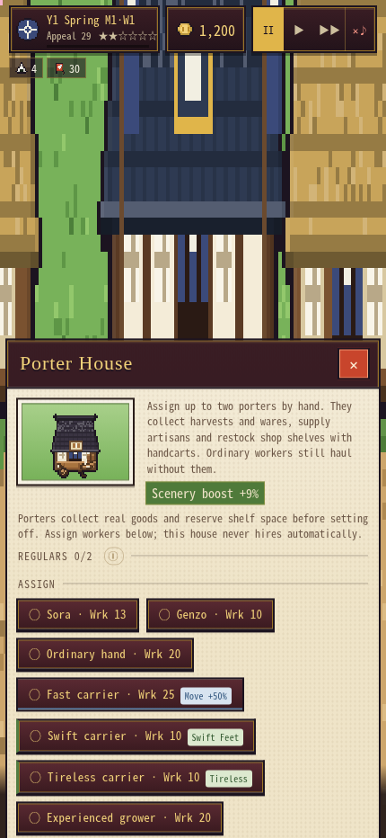
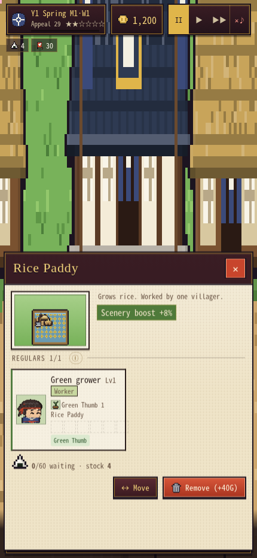
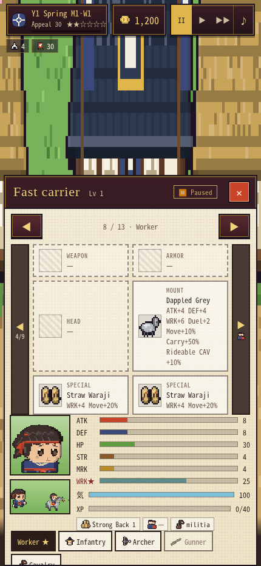
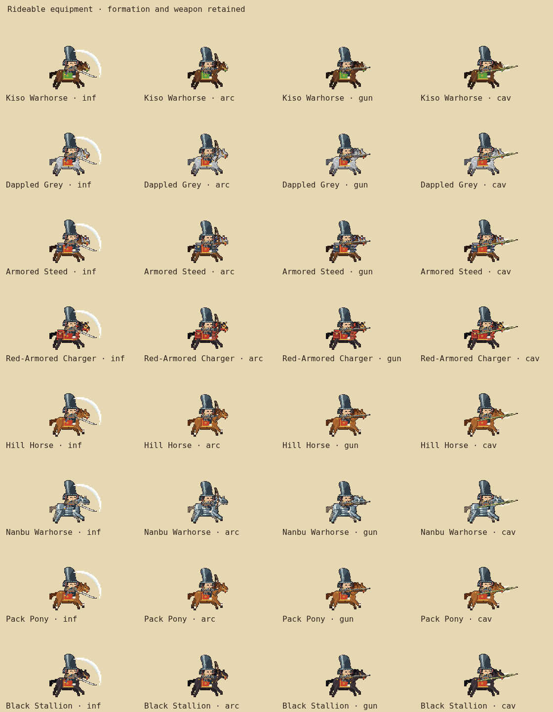

# Worker assignment highlights and mounted equipment

## Assignment UI

Porter House candidates and assigned-worker cards now show green **Swift Feet** / **Tireless** badges for active skills, and a blue movement badge when the current equipment/Swift movement bonus is at least **+50%**. Locked secondary skills do not qualify until learned. The threshold reads the existing `vStats().move` bonus, not an arbitrary walking speed in map pixels; road and carrying conditions do not flicker the highlight.

Rice Paddy, Daikon Patch and Tea Terrace assignments show active **Green Thumb** in green and current **Work 20+** in blue. This uses total current Work, including levels, equipment, calling and clan bonuses. Other worksites keep their existing controls. Workshop Fine Craft/crafting-equipment highlights remain unchanged.

`decorateAssignmentWorker()` runs only while building the existing assignment panel. It delegates Workshop cards to `decorateCraftWorker()` and reuses its green/blue badge palette. No worker sorting, automatic assignments, stats, resource movement or saved state changes.

## Equipped mounts

`battleRenderType()` picks the existing rider rig when equipment has the `ride` flag, independent of formation. This covers all eight currently rideable animals: Kiso Warhorse, Dappled Grey, Armored Steed, Red-Armored Charger, Hill Horse, Nanbu Warhorse, Pack Pony and Black Stallion. Companions without that flag keep their existing treatment; a wolf or bird does not turn into a horse. No animal gains new rideability or stat bonuses.

`soldierSprites()` preserves the equipped weapon, armor, headgear, coat and tack while generating rider frames. The original group type still controls formation, phase, targeting and movement orders. Mounted infantry do not become a cavalry formation; mounted archers and gunners keep their ranged attacks. The equipment panel's battle preview already uses this sprite builder and receives the same fix. Regular and reserve rescue retainers pass their equipped horse through the same kit builder, preserving its coat and barding.

Reaction recipes now record the visual rider type. Death dismounts the rider and releases exactly one existing horse sprite; routed riders remain mounted. Shadows, gallop frames, duel poses and the real-time adapter read the mounted appearance. Existing mounted duel reach and Zanbatō checks use equipment as well as rendered frames, so the headless resolver agrees with a watched duel without constructing an atlas. This recognizes the existing mount rules and adds no new mount bonus.

Sprites still use the existing bounded soldier cache and battle-lifetime ownership/release. No new sprite cache, per-frame canvas creation or save field was added. Real-time module/view sources remain synchronized with the standalone `index.html`.

## Verification

`node tests/assignment-mounts.cjs` checks actual assignment clicks, the exact +50%/20 Work boundaries, active secondary skills, already-assigned cards, all rideable animals in four formations, nonrideable companions, rank-and-file kit support, both armies and their equipped retainers, reserve rescuers, mounted duel/reaction poses, headless duel metadata, single horse release, real-time officers and cache cleanup. The fixture has 205 in-page assertions plus an equipment-panel check for a mounted worker, zero browser errors, and zero canvas allocations during 60 warmed real-time draws. It uses isolated game data and never opens a player's save. It also passes against the exported standalone HTML.

The related regression set covers Porter menu/save reload, clan crafting, equipment, mounted and other duel executions, cold duel playback, companion executions, field combat, real-time campaign, auto-resolve and armory presets. Native iPhone/Safari performance is not measured by these Chromium checks.

