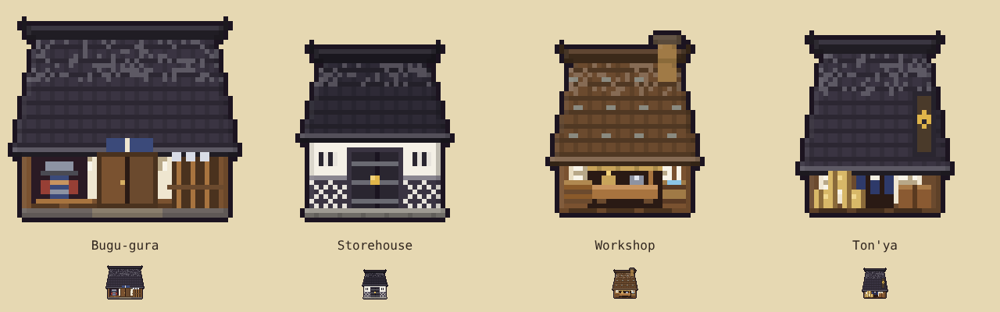
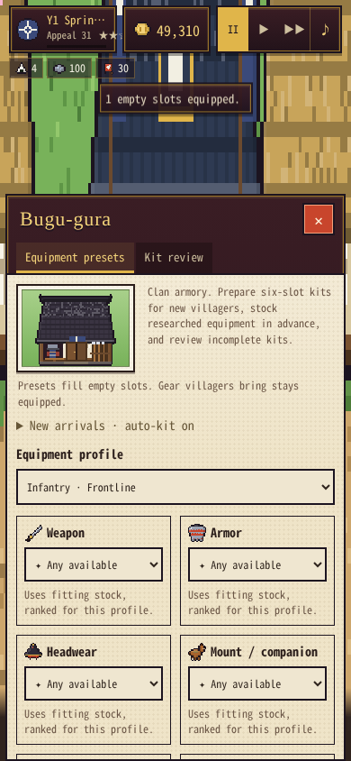

# Auto-resolve, courtyard volleys and Bugu-gura

## Controls and behavior

**Auto-resolve** appears beside the normal attack/march action on eligible province cards, plus hunt and land-challenge panels. It skips battlefield layout, soldier sprite generation and animation. Army journeys still take their normal time. The action's tooltip and result identify this as **staged combat**, even when the saved viewing mode is Real-time. The viewing preference is never changed. There is no new power-ratio victory roll.

The resolver uses the shared phase damage, infantry pursuit window, cohesion, offensive pressure, countershots, commander damage and round recovery. Battles finish through attrition or explicit retreat. HP duels consume `simDuel()`'s actual strike log once, including talisman/retainer rescues and commander consequences. With Auto Duel off, challenges are refused without opening a picker; the existing refusal penalty applies. With it on, champions are assigned automatically. This choice differs from the watched battle's interactive picker and is deliberate for an unattended action.

The same `finishBattle()` settles troop losses, wounds, Training Ground rewards, loot, conquests and captives once. The brief progress modal allows retreat; results are saved before Continue. Auto-resolved sieges use the army alone and **do not hire siege engines**. Choose the watched deployment for Bombards or Hwacha. Random results need not match a separately watched battle: animations consume randomness and Real-time uses physical projectiles.

**Courtyard arrows:** while the gate stands, attackers first target the wall's gunners/archers. Once both wall formations are gone, the *next volley* changes targets. Guns hit the gate; arrows fly in a high arc at infantry/cavalry behind it. The existing 0.45 siege-arrow modifier also receives a 0.35 high-wall accuracy modifier (0.1575 of comparable open-field raw arrow power). Commander personal damage receives the same reduction. Courtyard volleys can scatter between infantry/cavalry, cannot hit the gate, and still respect wards, defenses and live target counts. Once the gate breaks, ordinary field rules resume. Wall targeting is selected at volley start, so a volley that finishes the ramparts cannot also get an unearned gate/courtyard attack.

## Bugu-gura (武具蔵)

Build it under **Build → Training** for **750G**, on a 3×2 footprint with normal road access. Its warm timber, dark tiled roof, armor bay and spear rack share the village's native procedural art pipeline. It has no resident beds or worker jobs. Move/Remove use the existing building controls.

The **Equipment presets** tab has eight profiles:

| Calling | Profiles |
|---|---|
| Infantry | Duelist, Frontline |
| Archers / Gunners / Cavalry | One each |
| Workers | Delivery, Craft, Farm |

Every profile has weapon, armor, headwear, mount/companion and two special slots. Each slot selects a named item, **Any available**, or **Leave as is**. Any available chooses compatible owned stock ranked for the profile; it never buys a guessed item. Named gear may be planned before research, but purchases require the existing research, affordability and material checks. All purchases use normal prices and the goods ledger; Ton'ya/haul-reserved materials remain protected.

Expand **New arrivals** to enable automatic kits and choose infantry/worker defaults. It is off on new and migrated saves. New villagers keep gear they arrive with; presets fill only empty slots. Porter-assigned workers use Delivery, workshop-assigned workers use Craft, and other workers use the selected default. Kits also preserve calling requirements, such as firearms for gunners.

Per-profile **Buy missing researched gear** enables purchases when filling slots. **Keep one spare kit** maintains one unequipped copy per named slot per opted-in profile, adding quantities when several profiles or both special slots share an item. Restocking runs on arrival, research completion or **Stock spare kits**, not every frame. Unresearched or unavailable purchases wait without charging. There is no background treasury drain; purchases happen on these explicit events. Equipment already equipped does not count as spare stock.

The **Kit review** tab scans only when opened, when changing its fewer-than-five/six threshold, or on **Rescan**. Choose a compatible profile per listed villager and use **Fill missing** or **Equip listed**. Existing weapons and other equipment stay put. Filling a kit does not trigger a new village-wide scan, and a profile remembered for an old calling is discarded if that calling changes.

## Implementation and compatibility

- `startBattle()`, `beginRound()`, `collectPhaseHits()`, `preparePhaseEffects()`, `applyBattleHit()` and `endRound()` share battle setup and the damage ledger. `prepareAutoArmy()` supplies data-only commander handles. No battlefield canvas or battle sprite frames are built for auto-resolve.
- `autoResolveRound()` / `runAutoResolve()` resolve in short asynchronous chunks (up to eight rounds or roughly 8 ms between yields). Transient battle logs are bounded; the saved village gains no per-hit history.
- `resolvePhase()`, `heroPhase()`, `buildPhaseScript()` and `siegeScript()` implement wall/courtyard targeting. `siegeAttackPower()` keeps watched and auto gate arithmetic together.
- `migrateArmoryPresets()` runs from `afterLoad()` without changing inventory or equipped villagers. `G.v` stays 1. `G.armory` stores only eight fixed profiles, toggles and defaults (about 1.1 KB for default settings).
- `presetOnArrival()` hooks `addVillager()` after its normal calling/equipment setup; research completion triggers bounded spare-kit restocking. No per-frame villager scan or logistics changes.
- `buildingSprite()` normalizes Bugu-gura variants and levels to one cached procedural sprite. The panels use existing sheet/scroll behavior. There are no per-building overlays or new unbounded caches.
- Canonical new modules are `tools/modules/battle-auto-resolve.js` and `tools/modules/armory-presets.js`. Their `tools/apply-*.py` scripts synchronize only marked blocks in the playable `index.html`; do not regenerate from a historical baseline.

## Local validation

Ten Chromium/Playwright suites pass: auto-resolve, armory presets, siege, pursuit/siege, battle end, duel executions, equipment, real-time campaign, real-time review and campaign. No browser errors occurred in either new suite.

The auto-resolve suite covers march arrival, victory/loss/retreat, single settlement, hero-only formations, courtyard reduction, gate breach, actual duel HP logs and talisman/retainer rescues. The armory suite opens the real mobile Build menu, places Bugu-gura, configures all six slots/eight profiles, fills kits through the UI, verifies purchase material/gold deductions, duplicate-special quantities, bounded spare purchases, calling safety, snapshot behavior, migration/save reload and sprite-cache reuse. Reports are in `reports/auto-resolve/` and `reports/armory-presets/`.

Tests use isolated villages and do not touch a player's saved game. Physical iPhone/Safari validation is still required; these checks do not claim device FPS or memory measurements.
