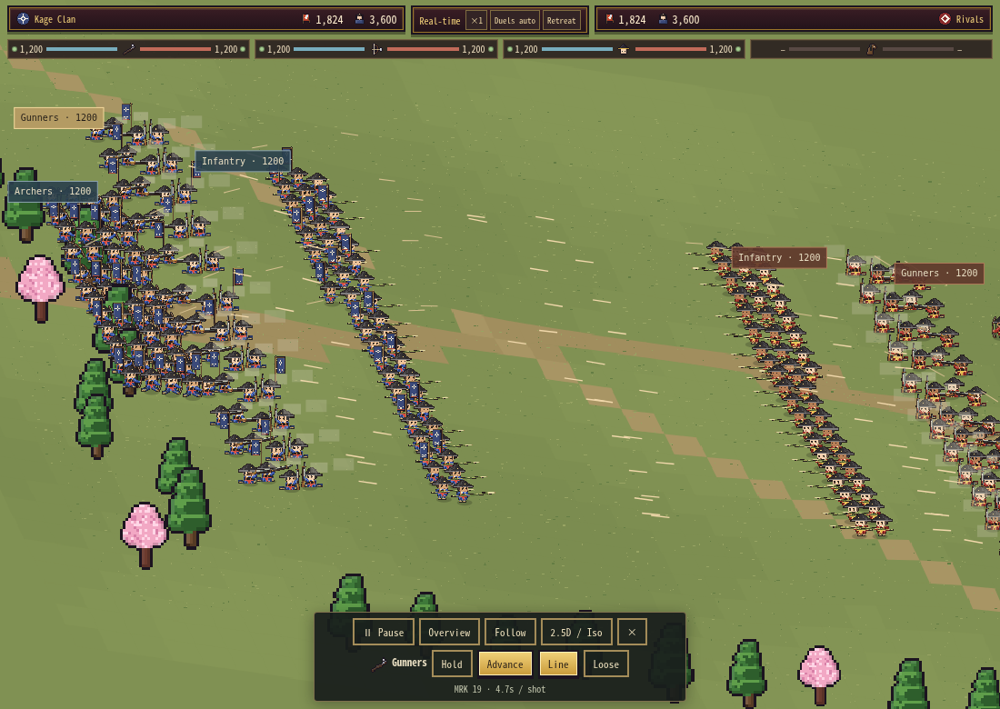

# Ranged engagement and gun reach

Gunners could successfully fire at targets placed inside their range, but the earlier volley checks missed a field-positioning failure. Guns reached 650 world units while bows reached 840. Supporting guns stayed 160 units behind the infantry's average position, with their own rear ranks another 69 units back. A held infantry screen therefore left half a full gun formation outside range. Supporting formations also kept following that stationary screen even when the remaining enemies were farther away; neither ranged formation would close the gap.

## Changes

- Real-time **gun range rises from 650 to 840**, matching bows. Close/mid-range dispersion through 650 is unchanged. Beyond 650, spread increases by another `0.065 × (distance − 650)` before the existing MRK/stance modifiers. This extends effective reach without making distant shots as reliable as close shots.
- Supporting ranged formations retain their usual spacing, but also compute an engagement position from the live enemy footprint, their own rear-rank depth, weapon reach and a 70-unit reserve. The farther-forward requirement wins. This lets them close on distant survivors despite an idle infantry screen, without repeatedly switching between support and firing positions. Large lateral gaps also cause a gradual alignment toward the enemy.
- **Hold remains authoritative.** Guns still require clear terrain sight; allies still cause no friendly fire or blocking. Bullets remain fixed straight rays and may miss moving targets or hit a different enemy.
- A blocked or newly out-of-range shot retry cannot continually renew a planted aiming pose. Guns retain planted recoil after an actual shot. A stale flank lane is released if its infantry screen disappears.
- Bow scatter radius increases by **14.3%** (`14 + .035d` → `16 + .04d`). Range, damage per landed arrow, base cadence, overhead fire, sampled endpoints, MRK benefits and Line/Loose trade-offs remain. This is a modest accuracy adjustment, not a fixed reduction to every volley.

Gun base cadence stays 6 seconds; bow cadence stays 3.25. Commander skills, wards, reload/burst metadata, HP accounting, Classic combat, siege-wall rules, saves and procedural artwork are unchanged. These are real-time engagement changes, so the earlier [damage comparison](battle-balance-performance.md) remains a record of the preceding PR rather than a claim that these new targeting outcomes match it.

## Reproduced before/after

The [paired campaign probes](../reports/realtime-engagement/) use the merged PR #43 build (`87591b9`) and the updated standalone, identical seed/armies and 48 figures per formation. Low attack and high defense keep targets available. Each case calls the real `updateBattle(1/60)` 3,600 times: 60 playback seconds, or 42 model seconds at the existing normal playback scale. No firing rates or time scale are changed for the probe.

| Journey | Gun figures with a target, sampled time share before → after | Shots before → after | Hits before → after |
|---|---:|---:|---:|
| Both armies advancing | 99.5% → 100.0% | 432 → 432 | 410 → 417 |
| Advance toward a held enemy | 98.7% → 100.0% | 432 → 432 | 404 → 418 |
| Both infantry lines held | 50.1% → 100.0% | 216 → 432 | 116 → 293 |
| Distant archers behind a held friendly screen | 0% → 80.6% | 0 → 365 | 0 → 159 |

The distant case includes walking into range and terrain-limited shots. It does not promise universal firing uptime. HP residuals in all five campaign probes are below `1e-6`; source SHA-256s are included in the raw files. The improvement comes from making idle ranks participate, not increasing per-hit damage or shortening reloads.

## Validation and cost

`tests/realtime-engagement.cjs` adds 109 browser checks against actual campaign armies and the shared continuous model:

- All 48 gun figures fire on **both sides** of held infantry lines.
- Distant back-line pursuit, stable firing position, explicit Hold, and genuinely out-of-range targets.
- An artificial raised terrain strip blocks held guns, while advancing guns reach a clear firing position through the existing lane movement. Friendly infantry takes no damage from its own shots.
- A stale blocked target between think intervals does not lock movement in the short retry/aim cycle.
- Eighteen isolated arrow samples cover three distances, two MRK values and three seeds. Both hits and misses occur; higher MRK still tightens spread and increases actual shot count.
- Identical 30/60-Hz engagement journeys, HP conservation, finite positions and nonnegative HP.
- The actual phone-sized campaign update/draw path with 384 troop figures plus 48 officers/guards. Warm rendering creates zero canvases; sampled backing is **47.25 MiB**. This is not a physical Safari or long-session memory claim.

The new approach calculation uses cached formation bounds and a few arithmetic operations per ranged formation. It adds no actor searches, per-frame objects, paths, canvases, caches or saved state. Existing target scans, projectile/effect pools and timers remain bounded. This is not a terrain obstacle planner: a deliberately held gun behind terrain cannot fire through it, and a completely impassable sight arrangement may still require an Advance order or repositioning.

A separate sequential before/after/after/before profile uses the existing `balancePerf()` / `balancePerfMeasure()` fixtures: eight 720-troop formations, 16 officers/32 guards, seed 77113, a 430×932 CSS viewport at device DPR 3, 120 warm frames and 360 measured frames. The [raw timing report](../reports/realtime-engagement/performance.json) averages to:

| Measure | Before | After |
|---|---:|---:|
| Median update call | 0.40 ms | 0.50 ms |
| Median drawing call | 2.85 ms | 3.15 ms |
| Frame p95 | 79.15 ms | 99.40 ms |
| Canvas backing after sampling | 47.96 MiB | 47.96 MiB |
| Canvases created during drawing | 0 | 0 |

The wider engagement creates more active projectiles and costs about 0.10 ms of median update work and 0.30 ms of median drawing in this sample. Software-rendered p95 still has large stalls in both versions; this is not a sustained device-FPS pass. Canvas backing and the bounded pools do not grow with the new range.

Run `npm run test:realtime-engagement`. `tools/probe-realtime-engagement.cjs` reproduces the five campaign journeys; `ENGAGEMENT_SOURCE` selects an older HTML and `ENGAGEMENT_REPORT` selects its output. The canonical model remains `prototypes/battlefield-25d/combat.js`; synchronize it with `python3 tools/apply-battle-realtime.py` and rebuild the isolated demonstration with `python3 tools/build-battlefield-prototype.py`.
