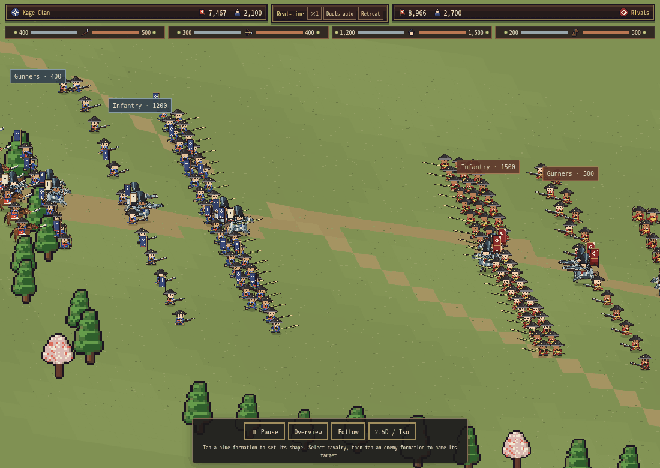

# Active real-time officers and burst guns

Regular officers previously lived in the renderer's extra-actor list. Their personal power multiplied soldiers' attacks, and their poses followed the formation's latest action. Moving an officer forward did not give him his own target, strike or projectile. Vanguard movement also stopped at a short lead and was cancelled during cavalry regrouping.

## Behavior and HP

- Active field officers now participate in the existing spatial targeting and hit/projectile pipeline, using their actual procedural weapon and own MRK. Their existing rendered actor is reused once; no duplicate rank-and-file figure is added.
- Vanguard/Spearhead officers pursue enemies and stay engaged while the cavalry formation withdraws/regroups. Mounted officers move faster and earn a first impact by covering 75 world units; staying in melee cannot repeatedly renew that charge bonus. Target changes do not send them back to an old slot.
- Ranged officers acquire targets, close to firing distance and use real bullets/arrows. Guns still need terrain sight and planted aim/recoil; bows keep overhead scatter. Both retain physical misses and zero friendly damage. A melee weapon in a ranged corps is used as a melee weapon instead of imaginary shots. Hunting beasts keep their original animal controller.
- Line cavalry follows its formation's cycle; Line melee officers support the clash. Honjin stays at camp. Explicit Hold stops pursuit while allowing nearby attacks. Retreat, KOs and duel/rescue outcomes remain authoritative.
- Healthy field officers fight on after their troops are gone. Their remaining HP determines combat capability, including across battle-window boundaries. Existing formation labels show the surviving officers, and a small health bar appears only while hurt. The final combatant's actual loss decides the battle.

Regular officers read/write **the existing `c.hp`**. Independent heroes retain their original `g.troops = c.hp / 3` model. No new soldiers, second commander HP pool or extra troop deductions are introduced. Ordinary soldiers retain their existing casualty-based rout behavior, including the 18% baseline chance.

## Personal power and protection

The old non-Honjin personal multiplier is removed from troop attacks and assigned to actual officer attacks. STR/MRK/ATK, post and existing diminishing commander weights determine their share; leadership and formation skills still affect the unit. Personal force is capped against original unit strength. Support falls below 30% remaining troops, reaching **one-third** when alone. Honjin retains its command contribution.

Only physical officer hits apply endurance pressure; rank losses no longer also hurt every officer through `cmdPressure()`. Direct hits reuse the pressure scale, post exposure, personal DEF, equipment guards and retainer protection. A six-man normalization floor keeps the scale finite with no troops; the mapping stays linear so Wards and stances retain their effect. Retainer attack amplification is capped at +100% to prevent a nearly empty formation from producing an unbounded ratio. `cmdHurt()` still handles KOs, leadership and lord consequences. Duel talismans, retainer rescues and recovery retain their HP pipeline.

Attacks use existing weapon reach and reusable wind/attack/follow/recovery poses. Claws are fast and short; heavy swords commit longer; bows/guns retain their ranged behavior. These attacks do not invoke cinematic freezes or add authored frames.

## Burst guns

`repeater.reload` and `rifle.reload` are now **0** in the shared item definitions. Both fire every eligible Classic gun phase and duel attack turn. Real-time uses one normal MRK interval between bursts, rather than two/three intervals: about **4.30 seconds at MRK 35** for either gun.

The two/three bullets still resolve separately, at 68%/60% power, with short intra-burst spacing, scatter, KO checks and the bounded projectile pool. Ordinary recovery/reload poses remain between attacks. Item descriptions/stat text no longer advertise extra reload turns. Prices, research tiers, barrel art and single-shot cadence are preserved. This intentionally strengthens both research weapons.

## Reconciliation correction

A whole-formation removal exposed an existing `reconcile()` bug. Casualty callbacks could rout remaining sources during the preferred-live pass. Their priority changed after the earlier dead-source pass had finished, leaving ghost HP; a later reconciliation counted their loss again. A final settlement sweep now handles them in the same call. The last-stand test removes 100 troops, checks the next battle window and verifies that their loss is paid once.

## Verification and limits

`tests/realtime-heroes.cjs` adds **133 checks** covering mounted charges, attacks during cavalry withdrawal, ranged targeting, actual kill credit, bounded power without duplicate troop buffs, officer HP hits and KOs, cancelled pending attacks, zero-troop last stands, final-officer defeat, Honjin, independent heroes, weapon/corps mismatches, hunting beasts, burst turns/intervals, 30/60-Hz equivalence and warm drawing.

In the mounted eight-officer fixture after ten model seconds, the infantry Vanguard lands eight strikes and a charge; the cavalry Vanguard lands five strikes and a charge; each rifle officer releases nine bullets; each archer releases five arrows. During two seconds of cavalry withdrawal, the Vanguard stays in contact and continues striking. These are geometry/accounting fixtures with deliberately low army attack and high defense, not campaign DPS estimates.

The 384 troop + 16 officer + 32 retainer render fixture uses **47.37 MiB** after collection and creates zero canvases in warm drawing. The [matched performance report](../reports/realtime-heroes/performance.json) uses sequential ABBA runs on the existing heavy-art fixture. All-sixteen-mounted sprite backing is an existing exception: **50.85 MiB in both versions**, above the historical 48 MiB goal. Artwork resolution was preserved. Physical Safari frame rate and long-session/app-switch stability remain unverified.

The matched heavy-art profile measures median update **0.45 → 0.60 ms**, drawing **3.70 → 3.65 ms**, and frame p95 **91.60 → 82.35 ms**. Canvas backing stays **47.96 MiB**, with zero draw-time canvas creation. These are software-rendered call costs, not device FPS; the noisy p95 is not a physical Safari performance pass.

Actor/weight arrays are allocated once per battle; decisions use the existing 0.18-second think interval; movement/combat uses the fixed step. No new sprite cache, per-frame canvas, actor DOM or saved state is added. Existing projectile/effect pools and procedural poses are reused.

The duel regression retains exact comparisons for **96 non-burst baseline ledgers**. The 24 Repeater/Rifle cases intentionally change with reload removal; equipment/duel tests verify their actual HP and bullets. Campaign, skill/Ward, siege, tactics, auto-resolve, cold duel playback, gunner engagement and the isolated prototype cover integration.

[Before](../reports/realtime-heroes/before.png) · [after](../reports/realtime-heroes/after.png) · [test results](../reports/realtime-heroes/results.json). Captured from actual campaign update/draw playback; these are not runtime assets.

Run `npm run test:realtime-heroes`. `tools/preview-realtime-heroes.cjs` records the field (`HERO_SOURCE` / `HERO_LABEL` select an older source/output label). `tools/probe-realtime-hero-performance.cjs` compares against the preceding gunner-engagement build. Canonical model/view/adapter modules are synchronized by `tools/apply-battle-realtime.py`; the isolated prototype is built separately.
