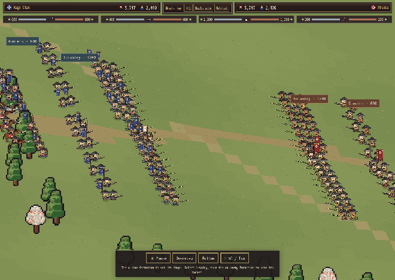

# Real-time volleys, hero skills and Vanguard behavior

The earlier checks covered damage, campaign settlement and render errors, but did not establish readable firing ranks. This review reproduces the actual campaign field rather than relying on the art viewer.

## Corrections

- Guns open in short rank volleys with small individual timing differences. MRK cadence, the 20% slower gun base interval, weapon reload trade-offs and long-range dispersion remain unchanged. A new target can still be engaged without waiting for an army-wide cycle.
- The old movement flag required a soldier to be more than 0.7 units from its slot. Steady slow marching moved less than that per fixed step, so troops slid in idle poses. The flag now reads actual displacement. Gunners plant their feet to aim/recoil, then continue moving/reloading, with readable aim and follow-through poses.
- Actual releases trigger the existing gun volley sound with a real-time rate limit. Short flashes and lighter smoke make firing ranks visible. Muzzle sockets come from the real procedural gun frame, including mirrored and mounted weapons; traces, smoke and flashes start there. The pixel artwork itself is unchanged.
- A bullet's physical start is capped at the target distance, fixing point-blank shots that began beyond the enemy. Fixed trajectories, swept enemy collisions, moving-target misses, lethal strays and zero friendly damage are preserved.
- The bounded projectile pool rises from 160 to 384 for coordinated rifle bursts and skill follow-ups. Pending burst rounds retry available capacity instead of being silently consumed. Casualties clear pending follow-ups. No new sprite cache or per-frame canvas creation is introduced.

## All 24 skills

Active primary and learned secondary skills use the existing `skv()` / `modsOf()` paths. Commander KOs still remove their active contribution through recalculation.

| Skills | Real-time route |
|---|---|
| Chain Strike | Restored delayed, separate in-range infantry follow-ups using the existing proc chance and bonus scale. Each hit resolves against actual HP. |
| Rapid Shot | Restored extra physical projectiles using the existing proc chance/bonus. Burst follow-up power includes its real bullet count and per-bullet power. |
| Countershot | Restored +30% per effective level on actual shots at nearby approaching/engaged melee attackers. Stationary distant targets receive no bonus. |
| Fury, Eagle Eye, Strategy | Existing attack modifiers, formation tactics and release-time tactic counters. |
| Arrow Ward, Bullet Ward, Horse Ward, Shadow Step, Iron Wall | Existing incoming damage/defense and Ki calculations. |
| Spearhead, Kenjutsu | Existing personal attack shares and HP duel bonuses. Spearhead also opts a field officer into forward behavior. |
| Horse Lord | Bonus applies to actual charge impacts; ordinary withdrawal swipes do not receive the charge multiplier. |
| Field Medic, Last Stand | Shared finite once-per-round recovery, bounded cohesion/pressure and actor HP reconciliation. |
| Siegecraft | Existing standing-gate Classic siege path before the real-time breach transition. |
| Quartermaster | Existing upkeep and post-battle wounded returns. |
| Strong Back, Green Thumb, Fine Craft, Swift Feet, Tireless, Haggler | Existing village work, hauling, crafting, fatigue and merchant effects. |

Chain Strike and Rapid Shot previously became small +3%-per-level passive multipliers, while Countershot had no live attack effect. Those shortcuts are removed. Follow-ups use the existing hit/projectile ledger; animations never create extra damage. Small bounded gold/blue cues mark real procs.

## Vanguard officers

Officers posted to **Vanguard**, or with active **Spearhead**, move ahead and seek nearby enemies in their forward direction. Melee officers press forward; ranged officers take an advanced firing position and keep using their equipped weapons. Line officers follow within the formation; Honjin officers stay at camp. Explicit Hold/Pikewall orders and cavalry withdrawal/regroup cycles remain authoritative.

Target selection runs every 0.18 game seconds through the existing spatial grid. Movement uses `dt`; parent references for guards/companions are resolved once instead of searching the extra-actor list each frame. Independent officers retain physical models. Regular officers retain the existing commander damage share, with animations following actual formation strikes. No extra army HP or second damage ledger is added.

## Reproduction and results

The paired baseline is commit `c1bbb15`. Each case uses the same layout, equipment, seed and 12 game seconds. This example has 600 logical gunners represented by 24 actors behind its infantry.

| Check | Before | After |
|---|---:|---:|
| Peak gunners firing within 0.25 seconds | 5 / 24 | 22 / 24 |
| Peak shots within 0.2 seconds | 4 | 12 |
| Ordinary gun shots in first 12 seconds | 60 | 72 |
| Ordinary gun hits in first 12 seconds | 57 | 59 |
| Vanguard lead over Line officer before contact | 0 | 84 world units, both sides |

The ready opening volley changes first-shot timing; subsequent reload intervals are unchanged. More simultaneous shots do not guarantee more hits: existing long-range scatter and moving-target misses still apply. [Comparison data](../reports/realtime-volleys/comparison.json) also includes rifles and stationary formations.

The live skill fixtures record 121 Rapid Shot follow-up projectiles, 162 Chain Strike follow-up hits and 48 Countershot-boosted shots. Numeric checks cover other attack/defense/duel/cohesion effects and once-only finite medicine. A 384-actor rifle/Rapid Shot stress field reaches 218 simultaneous projectiles and completes all 72 bursts that started. Conservation residuals remain below 1e-7, including externally removed actors and recovery. Gun sockets and point-blank hits are checked.

All **12 local suites pass**: volley/skills, real-time campaign, real-time review, standalone battlefield prototype, assignment/mounts, equipment, cold duel playback, field combat, siege, tactics, auto-resolve and armory presets. The prototype contributes 245 checks against the current canonical model. Browser-error lists are empty. Hardware Safari frame rate and sustained device memory remain unmeasured.

Matched stills: [before](../reports/realtime-volleys/before.png) · [after](../reports/realtime-volleys/after.png). The eight-second animation is captured from the actual campaign update/draw loop; it is not an authored animation or an extra runtime asset.

Regenerate with `node tools/probe-realtime-volleys.cjs`, `node tools/preview-realtime-volleys.cjs`, and `node tests/realtime-volley-skills.cjs`. `VOLLEY_SOURCE` selects an older standalone baseline. `python3 tools/apply-battle-realtime.py` synchronizes model/view/adapter code into `index.html`; the standalone prototype build remains isolated from the player's save.
